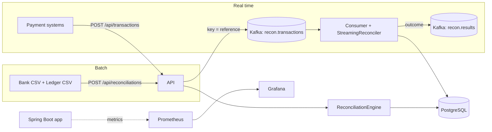

# Payment Reconciliation Platform

Every bank has the same headache: the money the bank says moved and the money your ledger says moved don't always agree. Fees shave off a few cents, settlements land two days late, a reference gets renamed somewhere along the way, or a payment just never shows up. Someone has to find those gaps, usually in a spreadsheet.

This service does that work automatically, both for nightly files (batch) and for transactions arriving one at a time (real time over Kafka). It pairs every bank transaction with its ledger entry, explains every mismatch in plain English, and keeps the history so you can see trends.

**Stack:** Java 21 · Spring Boot 3.5 · Kafka · PostgreSQL · Flyway · Micrometer · Prometheus · Grafana · Docker · GitHub Actions

---

## What it catches

| Status | Meaning |
|---|---|
| `MATCHED` | Same reference, amount and date (within tolerance) |
| `PROBABLE_MATCH` | References differ, but account, currency, amount and date all line up. Flagged for a quick human check |
| `AMOUNT_MISMATCH` | Paired by reference, but the amounts differ (fees, FX rounding, keying errors) |
| `DATE_MISMATCH` | Paired, but settled outside the allowed lag |
| `CURRENCY_MISMATCH` | Paired, but booked in different currencies |
| `UNMATCHED_BANK` | The bank shows it, the ledger doesn't |
| `UNMATCHED_LEDGER` | The ledger shows it, the bank doesn't |
| `DUPLICATE` | The same reference appears twice on one side |

## Architecture



The code is split in two on purpose:

- `core/` is plain Java with no framework imports. All the matching logic lives here, so it's fast to test and easy to reason about.
- Everything else (`api/`, `service/`, `kafka/`, `persistence/`) is a thin Spring layer around it.

### How batch matching works

1. **Duplicates.** Repeated references on either side are flagged and set aside.
2. **Exact pass.** Pair by reference (case and whitespace don't matter), then check currency, amount and date in that order.
3. **Probable pass.** For whatever's left, look for a ledger entry on the same account with the same currency and amount, within the date tolerance. Candidates are indexed by account and currency, so this pass stays fast even on big files. When several fit, the closest date wins, and a ledger entry can only be claimed once.
4. **Leftovers** become `UNMATCHED_BANK` or `UNMATCHED_LEDGER`.

### How real-time matching works

Each transaction waits in memory until its counterpart arrives. Messages are keyed by the normalized reference, so both halves of a payment always land on the same Kafka partition and the same consumer. That's what makes the in-memory approach safe to scale out across instances. Anything that waits longer than `recon.pending-max-age` (default 1 hour) is expired and reported as unmatched by a scheduled job.

## Quick start

You need Java 21, Maven 3.9+ and Docker.

**Option A: everything in Docker (app, Postgres, Kafka, Prometheus, Grafana)**

```bash
docker compose up --build
```

- API: http://localhost:8080
- Grafana dashboard: http://localhost:3000 (Dashboards → Reconciliation)
- Prometheus: http://localhost:9090

**Option B: run the app from your IDE**

```bash
docker compose up -d postgres          # just the database
mvn spring-boot:run                    # Kafka off by default; streaming runs in-process
```

To use Kafka from the IDE, also start it and point the app at the host listener:

```bash
docker compose up -d kafka
RECON_KAFKA_ENABLED=true KAFKA_BOOTSTRAP_SERVERS=localhost:29092 mvn spring-boot:run
```

## Try it

**Batch run with the included sample files** (about 1,000 transactions with known problems baked in):

```bash
curl -s -F bank=@sample-data/bank.csv -F ledger=@sample-data/ledger.csv \
  http://localhost:8080/api/reconciliations | jq '.summary'
```

**Look up a run, or page through every open exception:**

```bash
curl -s http://localhost:8080/api/reconciliations                       # recent runs
curl -s http://localhost:8080/api/reconciliations/<runId> | jq '.summary'
curl -s "http://localhost:8080/api/exceptions?status=AMOUNT_MISMATCH&size=20" | jq
```

**Real time: send both sides of a payment:**

```bash
curl -s -H 'Content-Type: application/json' http://localhost:8080/api/transactions -d \
 '{"source":"BANK","reference":"PAY-1","accountId":"ACC1","amount":42.00,"currency":"USD","valueDate":"2026-03-01"}'

curl -s -H 'Content-Type: application/json' http://localhost:8080/api/transactions -d \
 '{"source":"LEDGER","reference":"PAY-1","accountId":"ACC1","amount":42.00,"currency":"USD","valueDate":"2026-03-02"}'
```

With Kafka on, the API returns `202 QUEUED` and the outcome is published to `recon.results`. With Kafka off, the second call returns the result directly.

**CSV format.** Columns are matched by header name, in any order: `reference, account_id, amount, currency, value_date (yyyy-MM-dd), description (optional)`. Quoted fields and thousands separators are fine. Bad rows are skipped and listed in `parseErrors` instead of failing the whole file.

## Configuration

| Property | Env var | Default |
|---|---|---|
| `recon.amount-tolerance` | `RECON_AMOUNT_TOLERANCE` | `0.00` |
| `recon.date-tolerance-days` | `RECON_DATE_TOLERANCE_DAYS` | `2` |
| `recon.pending-max-age` | `RECON_PENDING_MAX_AGE` | `PT1H` |
| `recon.kafka.enabled` | `RECON_KAFKA_ENABLED` | `false` |
| `spring.datasource.url` | `DB_URL` | `jdbc:postgresql://localhost:5432/recon` |
| `spring.kafka.bootstrap-servers` | `KAFKA_BOOTSTRAP_SERVERS` | `localhost:9092` |

## Testing and performance

```bash
mvn verify          # unit tests for the engine + end-to-end API tests on H2
```

**Engine benchmark** (pure matching speed, no HTTP or DB):

```bash
mvn -q compile
java -cp target/classes com.junaid.recon.core.EngineBenchmark 100000 5
```

**Generate bigger sample files:**

```bash
java -cp target/classes com.junaid.recon.core.SampleDataGenerator 50000 sample-data 42
```

**Load test the real-time API** with [k6](https://k6.io), while watching Grafana:

```bash
k6 run -e RATE=500 -e DURATION=2m loadtest/stream-load.js
```

Record your own numbers here once you've run these on your machine:

| Measurement | Result |
|---|---|
| Engine throughput (100K txns) | _fill in_ |
| Batch API, 50K-row files, end to end | _fill in_ |
| Streaming API sustained rate, p95 latency | _fill in_ |

## Deploying to AWS

One straightforward path:

1. Push the image to **ECR** (the CI workflow already builds it).
2. Run it on **ECS Fargate** behind an Application Load Balancer.
3. Use **RDS for PostgreSQL** and **Amazon MSK** (or MSK Serverless) for Kafka.
4. Pass `DB_URL`, `DB_USER`, `DB_PASSWORD`, `KAFKA_BOOTSTRAP_SERVERS` and `RECON_KAFKA_ENABLED=true` as task environment variables, with secrets in **Secrets Manager**.

## Design decisions worth talking about

- **Why split `core` from Spring?** The matching rules are the valuable, risky part. Keeping them framework-free means fast tests and no hidden behavior.
- **Why JDBC batching for writes?** JPA can't batch inserts when IDs come from an identity column. `JdbcTemplate.batchUpdate` in chunks of 1,000 is far quicker for large files, while JPA stays for reads.
- **Why key Kafka messages by reference?** It guarantees both sides of a payment reach the same consumer, so pending state can live in memory without a shared cache.
- **Why "probable" instead of auto-matching?** A different reference with the same amount is usually the same payment, but not always. Flagging it keeps a human in the loop on the risky calls.
- **What would I add next?** Persisting pending stream state (Redis or a compacted topic) so a restart doesn't drop it, a dead-letter topic for unreadable messages, and per-account tolerance rules.

## Project layout

```
src/main/java/com/junaid/recon
├── core/          matching engine, streaming reconciler, CSV parser, sample data, benchmark
├── api/           REST controllers, request/response types, error handling
├── service/       batch runs, streaming, metrics
├── kafka/         topics, publisher, consumer
├── persistence/   JPA entities, repositories, JDBC batch writer
└── config/        properties and bean wiring
src/main/resources/db/migration   Flyway schema
monitoring/                       Prometheus + Grafana (dashboard provisioned automatically)
loadtest/                         k6 script
sample-data/                      generated bank and ledger CSVs
```
